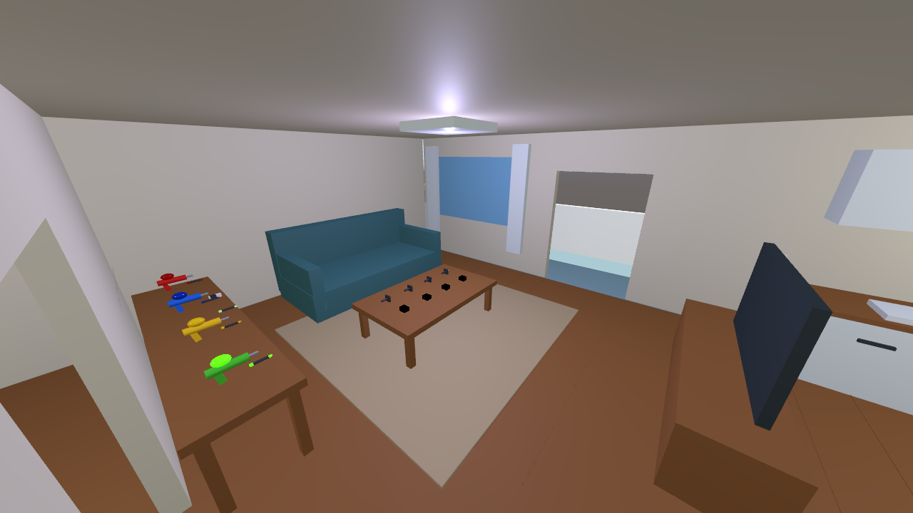
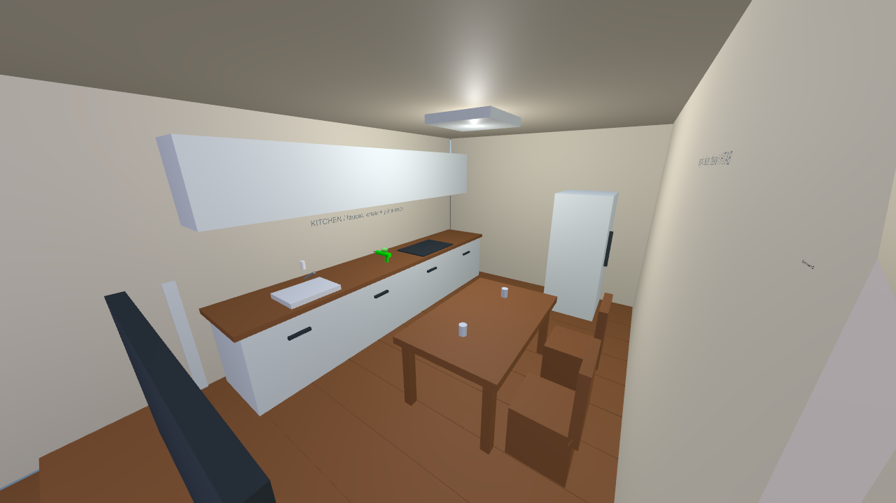
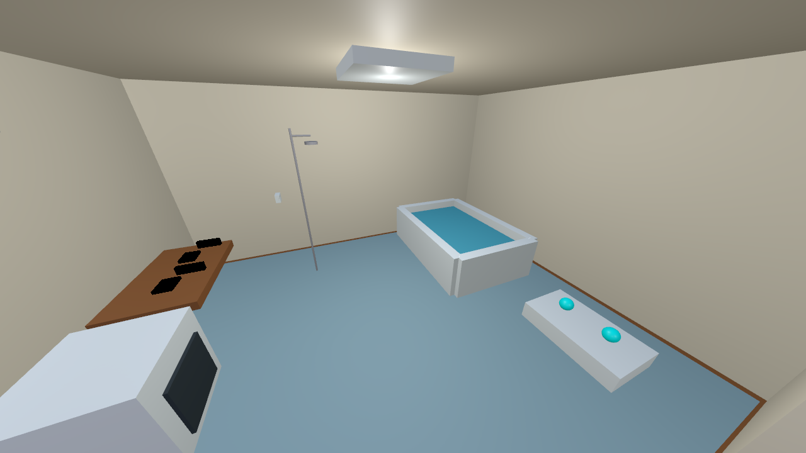

# マンションの室内サンプル

Liquid Apartment は、リビング兼ダイニング、キッチン、浴室・洗面、玄関、バルコニーを備えた複数人用サンプルです。基本形状による家具・内装と、実際に操作できる Liquid の道具を組み合わせています。

## 起動

`Tools > SabaProps > Liquid > Create Apartment Scene` で `Assets/SabaProps/Liquid/Samples/LiquidApartment.unity` を生成します。既存の Playroom や Contact シーンは上書きしません。Apartment 自体を編集した場合は、再生成前に別名で保存してください。

プレイヤー用 Canvas は 8 人分、スポーンは玄関に 4 か所です。玄関からリビングと浴室へ移動でき、リビングからキッチンとバルコニーへ進めます。出入口の有効幅は 1.6 m、高さは 2.3 m です。玄関の外扉は装飾で開閉しません。

## 部屋と機能

| 部屋 | 家具・内装 | 操作できる Liquid の機能 |
| --- | --- | --- |
| リビング | ソファ、ラグ、ローテーブル、テレビ台、描画机、窓・カーテン | 4 色のスプレー・ペン・星スタンプ、スポンジ、蓄光ペン、消しゴム。照明と UV のスイッチで蛍光・蓄光を確認 |
| キッチン・ダイニング | キッチン収納、天板、コンロ、冷蔵庫、食卓・椅子 | 蛇口、水とジュースのコップ、スライムスプレー。コップは持って Use すると内容物を放出 |
| 浴室・洗面 | 浴槽、洗面台、鏡、洗濯機、タオル棚、風呂椅子 | シャワー、洗面の蛇口、浴槽への浸漬、シャワー連動の湿度・結露、水鉄砲、タオル、水風船 |
| 玄関 | 玄関扉、下駄箱、濡れたマット | 泥スプレー、水入りバケツ、傘 2 本、浅水への踏み込みによる飛散、リセットパネル |
| バルコニー | 床・手すり | 雨による濡れ、傘による遮蔽 |

テレビ、冷蔵庫、コンロ、洗濯機、収納は装飾です。家電の動作や扉の開閉は実装していません。浴槽の水位は固定で、給排水による水位変化はありません。鏡は VRChat SDK の標準ミラーです。

## 確認例

1. 各自がリビングの別の色の道具を持ち、相手や壁・床に描きます。濡れた模様を手でこすり、別の面へ転写します。
2. キッチンのコップや玄関のバケツを持って Use し、液体を放出します。
3. 浴室の `Shower on/off` を押し、シャワーを浴びて洗浄します。出している間は浴室の湿度が上がります。蛇口は本体への Interact で切り替えます。
4. 浴槽へ入り、浸漬による濡れを確認します。タオルを付着面へ当てて拭き取り、水風船は Use による足元への投擲または VR の手投げで使います。
5. 玄関の濡れたマットを踏み、飛散を確認します。傘を持ってバルコニーへ出て、雨の遮蔽を確認します。
6. リビングで蛍光・蓄光塗料を描き、`Room light` と `UV light` を切り替えます。背景の明るさも他室の照明や環境光に影響されるため、完全な暗室ではありません。

リセットパネルは玄関のリビング側にあります。自分・全員・壁の塗料を消去できます。シャワーや雨の発生源はリセットでは停止しません。

## 描画・同期の範囲

室内とバルコニーの床・壁・家具は共通の Surface Canvas（面解像度 256、Painted Wall の応答特性）に含めています。木・タイル・布の見た目は異なりますが、家具ごとの吸収率は分けていません。Pickup はそれぞれの既存設定に従い、鏡は環境用の液体投影から除外しています。

環境用 Canvas の液体照明はリビングの Light Zone を共有します。そのため壁などの液体に対する UV の効果は部屋ごとには分離していません。プレイヤーへの照明と浴室の湿度は、それぞれのゾーン範囲で適用します。

複数人の操作は各自が別の道具を持って確認してください。途中参加時の履歴やクライアント間の描画差、VR での確認項目は [Playroom の同期と確認手順](playroom.md) と [接触・転写](contact.md) に従います。8 枠は人数分の割り当て容量であり、8 人同時操作の性能を保証するものではありません。
