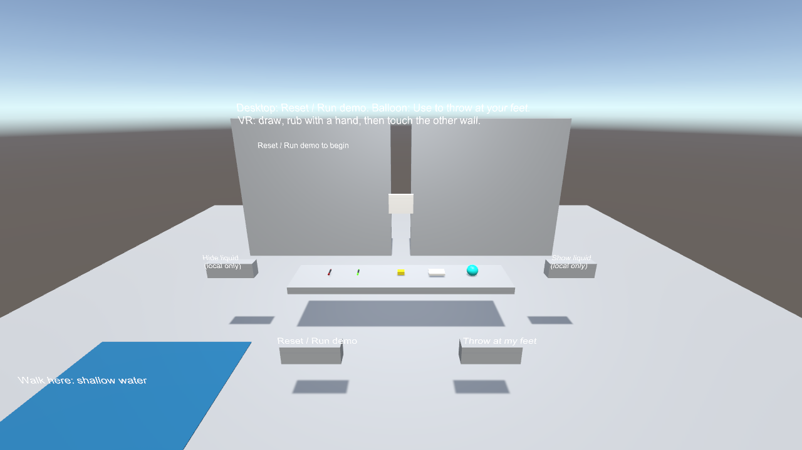
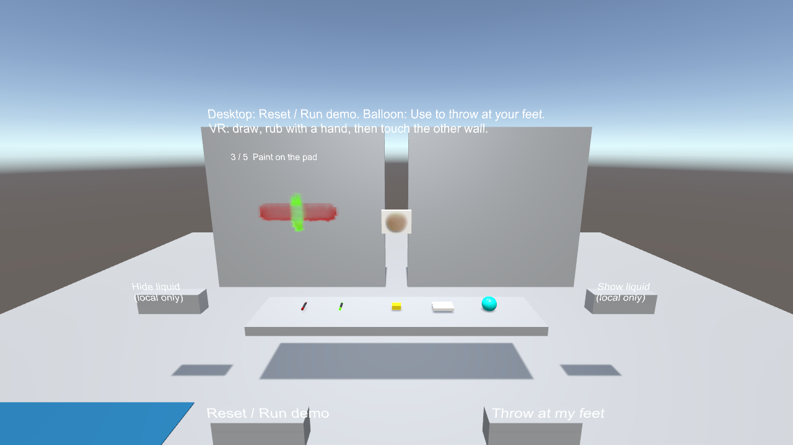

# 接触、転写と飛散

接触機能は、描かれた模様を手や体、道具へ移し、転写元を薄くします。濡れた塗料をこすると移動方向へ模様が伸びます。顔料と液膜に加え、蛍光・蓄光の割合も転写します。乾いた顔料の転写量は濡れたものより小さくなります。

## 導入

1. ワールドの描画対象に Surface Canvas と Collider を置き、`Register Paint Tools and Surfaces` で登録します。
2. `Tools > SabaProps > Liquid > Enable Contact in Scene` を実行します。Canvas Pool に接触判定と Limb Canvas が追加され、既存 Canvas に接触用マテリアルが設定されます。再実行しても Limb Canvas を重複作成しません。
3. スポンジ、タオル、水風船は Hierarchy の `SabaProps > Liquid > Contact` から追加できます。

既存の 0.1.0 シーンでも、接触による転写・変形は明示的に有効化するまで実行しません。元のシーンを残す場合は先に別名で保存してください。距離による更新・表示の制限は接触の有効化とは独立した設定で、既定値は後述の「負荷制御」を参照してください。

## Contact デモ

`Tools > SabaProps > Liquid > Create Contact Scene` は、`Assets/SabaProps/Liquid/Samples/LiquidContact.unity` を生成します。0.1.0 の同梱 4 シーンとは別のシーンです。生成先を編集済みの場合、再生成で置き換わるため先に別名で保存してください。

### Desktop での最短確認

1. 生成したシーンを ClientSim の Play、または VRChat の Desktop mode で開きます。
2. 正面の `Reset / Run demo` を押します。約 11 秒で、左壁への塗布 → パッドでこする → パッドへの付着を表示 → 右壁へ転写 → 左壁を拭き取る、の順に進みます。左壁の模様の減衰、パッドの色、右壁への再付着を確認します。再度押すと初期化して繰り返します。
3. `Throw at my feet` を押します。水風船が、押した時点の自分の足元へ投げ出されます。床への衝突・飛散・8 秒後の再出現を確認します。水風船を拾って Use しても同じ投擲になります。途中の壁や物体に当たった場合は、その位置で破裂します。

デモは通常の接触と同じ Canvas 転写処理を使います。パッドの移動を自動化しているため、アバターのボーンによる接触判定・追従や VR の両眼描画の確認は別途必要です。接触判定は手だけでなく、既定では両足・胸・頭も対象です。Desktop のアバター姿勢で狙った部位を壁に当てる操作を省くためのデモです。

`Reset / Run demo` は現在参加している利用者に開始を通知し、デモの壁とパッドの塗料およびシーンの Paint Log を消します。途中参加者へのデモ再生はありません。通常の描画を残したい場合は押さないでください。

### 手動での接触・道具・VR 確認

- 左の壁に赤いペンで線や文字を描き、手でなぞります。模様の伸びと減衰、手への付着を確認します。
- その手で右の壁に触れ、再転写を確認します。腕を動かしたとき、付着が手に追従することも確認します。
- 蛍光ペンでも同じ操作を行います。照明は点灯・UV・消灯を繰り返します。VR では片眼ずつ確認します。
- スポンジとタオルは、先端を壁へ押し当てて動かします。塗料の除去と道具への付着を確認します。
- 水風船を壁や床へ投げます。既定の衝突速度を超えると破裂し、周囲へ液を付け、8 秒後に戻ります。
- 左手前の青い浅水範囲へ踏み込み、歩行による飛散を確認します。
- `Hide liquid locally` / `Show liquid locally` で、その利用者だけの付着表示を切り替えます。

自動接触判定は両手・両足・胸・頭の近傍から行います。Limb Canvas が前腕や下腿への付着に対応していても、それらを起点とする接触判定を追加するものではありません。

## 設定

| 対象 | 主な項目 | 効果 |
|---|---|---|
| `LiquidContact` | `radius` | 接触を近似する半径。アバターの目の高さで補正します |
| 同上 | `transferFraction` / `smear` | 転写率と、濡れた塗料の変形量 |
| 同上 | `includeFeet` / `includeBody` | 足、胸・頭の接触判定を有効にします |
| `LiquidWipeTool` | `absorption` / `redeposit` | 除去・吸着の強さと、汚れた道具からの再付着率 |
| 同上 | `clothCanvas` | 道具の汚れを保持する Canvas。未設定なら除去だけ行います |
| `LiquidWaterBalloon` | `impactSpeed` / `respawnSeconds` | 破裂する衝突速度と再出現時間 |
| 同上 | `throwAtFeetOnUse` / `throwFlightSeconds` | Use による足元への投擲と、障害物がない場合の到達時間（0.3～1.5 秒）。通常の手投げも使用できます |
| `LiquidSplash` | `rays` / `range` / `markRadius` / `amount` | 飛散の判定数、距離、付着半径と量。量は判定数で分配します |
| `LiquidImmersionVolume` | `stepSplash` / `stepDistance` | 踏み込み用の飛散と歩行間隔。未設定なら従来の浸漬だけです |

独自の浅い水に飛散を追加する場合は `LiquidSplash` を置き、`pool` と `profile`、`emissionVolume` に液体の Trigger Collider を設定します。`LiquidImmersionVolume.stepSplash` から参照します。足元が液面から 35 cm より深い場合は、踏み込みによる飛散を発生させません。

道具を複製する場合、Projector マテリアルも道具ごとに複製してください。メニューから追加した道具には、それぞれ別のマテリアルを生成します。

## Limb Canvas

手、足、頭、前腕、下腿への局所的な付着は、近傍の Humanoid ボーンに追従する Canvas で扱います。接触・描画の入力時に割り当てます。既定は 1 人 4 部位までで、シーン全体では Body Canvas 数の 4 倍、生成時最大 48 枚です。空きがない場合やボーンがない場合は Body Canvas を使用します。

アバター変更、退出、プレイヤーのリセット時に部位の割り当てを解放します。RenderTexture は再利用のため保持します。Limb Canvas の解像度は既定で 1 面 64 px、範囲は各軸の半径 18 cm です。大きいアバターでは、対象部位を覆うよう範囲と Projector を調整してください。

任意のアバターのメッシュを変形・解析する方式ではありません。ボーンの箱による投影なので、関節をまたぐ付着、近接した別の部位、衣服の揺れに厳密に追従するものではありません。

## 負荷制御

Canvas の `simulationDistance` より遠くでは流下・乾燥の定期 RenderTexture 更新を止め、`displayDistance` より遠くでは Projector を非表示にします。0 は距離制限なしです。既定は Body / Surface が 25 m・50 m、Limb が 12 m・20 m です。近づくと再開しますが、停止中の流下の経過を再計算するものではありません。入力の確定に必要な更新は距離制限中も発生します。

接触は既定で 1 クライアントあたり 1 フレーム 2 回、1 秒 20 回までです。超過した接触は両側を変更せず省略します。`GetAcceptedContacts()` と `GetDroppedContacts()` で件数を確認できます。複数人が同時に接触する場合は、上限と描画負荷の両方を確認してください。

ローカル非表示中はプール経由の新しい付着を受け付けず、既存 Canvas の定期更新を止めます。再表示時に、無効中の入力は再生しません。Source のパーティクルや水面の Mesh はこの設定の対象外です。

4 種類の RenderTexture を 2 枚ずつ持つため、1 枚の Canvas の使用量は `1 面の解像度² × 6 × 40 byte` が目安です。64 px で約 0.94 MiB、160 px で約 5.86 MiB、256 px で 15 MiB です。深度バッファやドライバー側の管理領域は含みません。

Unity 2022.3.22f1、RTX 2070 SUPER の Editor で、接触シェーダーの除去パスを 100 回実行して ReadPixels で完了を待った計測では、64 / 160 / 256 px が 1 パス約 0.007 / 0.012 / 0.021 ms でした。これは CPU の発行と完了待ちを含むバッチ計測です。Udon の処理、Projector、VR の両眼描画やアバターの負荷は含まず、VR のフレーム時間を保証する値ではありません。1 回の片方向転写は 8 パス、双方向接触は 16 パスです。

## 同期と近似

接触した利用者が対象・接触位置・法線・動き・連番を配信し、各クライアントが自分の Canvas を更新します。道具と水風船は所有者が操作を確定します。RenderTexture の画素をネットワークへ送る方式ではありません。

既存の Paint Log はペン・スタンプ・消しゴムの履歴です。接触による変形・転写・除去、水風船、踏み込みの履歴は途中参加者に再生しません。途中参加者が見る転写元の模様は、先に入った人と異なる場合があります。流下・乾燥、アバターの姿勢、処理上限による省略にもクライアント間の差があります。画素単位の一致が必要な用途には使用しないでください。

転写は元の顔料量に比例し、元からも同じ転写率で減らします。ただし、投影面の解像度差、補間、模様の変形、重ね塗りの被覆率を含むため、物理的な質量保存を保証する計算ではありません。接触点はボーン付近からの短い光線で近似し、手指のメッシュ形状を取得するものではありません。
