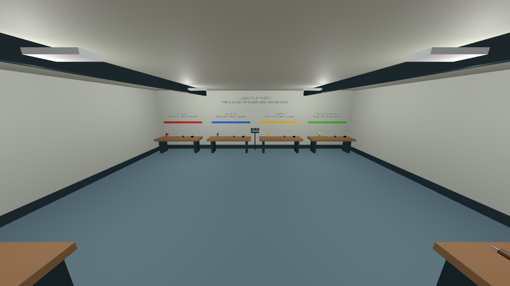

# 複数人向けの屋内サンプル

Liquid Playroom は、複数人で互いのアバターや床・壁を汚し、水や布で落とすための室内サンプルです。12 × 10 m、高さ 3.6 m の一室を Unity の基本形状から生成します。外部モデルは使用しません。

## 生成と起動

1. `Tools > SabaProps > Liquid > Create Playroom Scene` を実行します。
2. `Assets/SabaProps/Liquid/Samples/LiquidPlayroom.unity` が生成されます。既存の Contact デモや同梱の 4 シーンとは別です。同じ生成先を編集している場合は、再生成前に別名で保存してください。
3. まず ClientSim の Play で室内の配置と道具を確認します。複数人の検証では VRChat SDK の Build & Test で複数クライアントを起動するか、アップロードしたワールドの同一インスタンスに参加します。

初期設定はプレイヤー用 Canvas 8 枠、スポーン地点 4 か所です。中央の空間で相手と向き合い、周囲の台から各自の道具を選びます。歩行速度は 2 m/s、走行速度は 4 m/s です。

## 道具と操作

| 場所 | 道具 | 操作 |
| --- | --- | --- |
| 奥の 4 台 | 赤・青・黄・蛍光緑のスプレー、ペン、星スタンプ、スポンジ | 各自が別の道具を持ち、相手・床・壁に向けて Use。スポンジは濡れた模様に当ててこする |
| 手前の洗浄台 | 水鉄砲 2 個、タオル 2 枚 | 水を噴射して塗料を洗い、布を接触させて拭き取る |
| 手前の飛散用の台 | 泥・スライムのスプレー、水風船 2 個 | スプレーは Use を保持。水風船は Use で自分の足元へ投擲、VR では通常の手投げも可能 |
| 奥中央 | リセットパネル | 自分・全員・壁の塗料をそれぞれ消去 |

床、4 面の壁、天井、作業台は共通の Surface Canvas の対象です。液体の流れ方は Painted Wall の特性を共有します。床と壁で異なる吸収率などを試す場合は、対象の範囲が重ならないよう Surface Canvas を分割してください。

## 2 人での確認手順

1. それぞれ異なる色のスプレーを持ち、相手の胴体・手足へ噴射します。両方の画面で付着を確認します。
2. 壁にペンやスタンプで描き、濡れた模様を手でこすります。手への付着、元の模様の減衰、別の壁へ触れた際の転写を確認します。
3. 相手の汚れに水鉄砲を当てます。床・壁も塗布してから水やタオルで落とします。
4. 水風船を使い、衝突箇所からの飛散と 8 秒後の再出現を確認します。
5. リセットパネルの全員・壁の消去が両方の画面へ反映されることを確認します。

Desktop でも噴射・描画・水風船は操作できます。ボーンへの接触・こすり方と両眼の描画は VR でも確認してください。接触だけを短時間で確認する自動デモは [Contact シーン](contact.md) にあります。

## 同期と負荷

各道具は独立した Pickup です。同じ道具を同時に操作するのではなく、各自が別の道具を使います。プレイヤー用 Canvas は 8 枠、部位用 Canvas は最大 4 枠/人です。人数を増やす場合は Canvas Pool と接触用の割り当て上限を併せて調整します。

室内の Surface Canvas は 1 個、面解像度は 256 です。広い面では細い線が粗くなることがあります。解像度を上げると描画用メモリも増えます。

同期するのは操作と入力で、液体テクスチャそのものではありません。姿勢や更新時刻によって、模様は各クライアントで完全には一致しません。途中参加時の Paint Log の再生はペン・スタンプ・消しゴムが対象で、噴射・接触転写・飛散の履歴は復元しません。詳細は [利用方法](authoring.md) と [接触の制限](contact.md) を参照してください。
