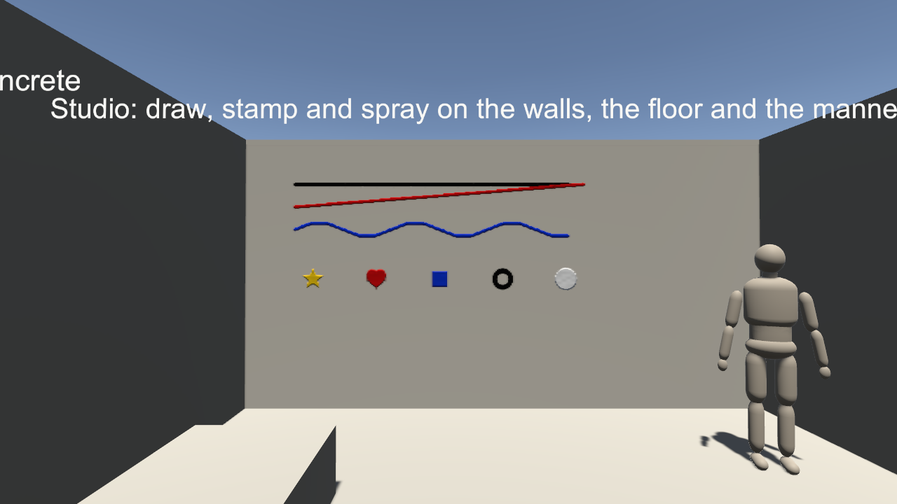

# SabaProps Liquid

ワールド側から、アバターとワールドの表面へ液体の付着を描画する Udon パッケージです。
水、塗料、泥、粘性の高い液体などが表面に付着し、垂れ、乾き、洗い流される様子を Projector で描画します。

- アバター（ローカル、リモート、鏡像）と、ワールドの壁や床の両方に描画します。アバター側の対応は不要です
- 液体の見た目は液体の定義（色、粘性、乾燥時間など）で、付き方は受け手の素材（布、革、肌、タイルなど）で変わります
- プール、シャワー、水鉄砲、噴射器、雨と雪、湿度などの発生源（Source）と、向けた先に描くペン、スタンプ、消しゴムを含みます
- 同期するのは描画に必要な入力だけです。演出のためのパッケージで、勝敗や得点などの仕組みは含みません
- 対象は PC のみです

## ドキュメント

| 文書 | 内容 |
|---|---|
| [利用方法](Documentation~/authoring.md) | 自分のワールドへの組み込み、Prefab、壁と床、描画ツール、環境、同期、メモリの目安 |
| [サンプルの導入とレビュー](Documentation~/demo.md) | 同梱の 4 つのワールドの内容と確認項目 |
| [設計](Documentation~/design.md) | 方式、制約とその理由、未確定事項 |
| [接触、転写と飛散](Documentation~/contact.md) | こすれ、手・体・道具への転写、Desktop 自動デモ、Limb Canvas、水風船、踏み込み、負荷制御 |
| [変更履歴](CHANGELOG.md) | バージョンごとの変更点 |

## 導入

VCC でこのパッケージを追加すると、依存する VRChat Worlds SDK（3.10.x）も一緒に解決されます。

最小の構成は次のとおりです。詳細は [利用方法](Documentation~/authoring.md) を参照してください。

1. Hierarchy の右クリックから `SabaProps > Liquid > Prefabs` の Source（Shower、Spray Gun など）を置きます。
   Canvas Pool が無ければ同時に作成されます
2. ワールドの主光源に `Liquid Lighting` を付けます
3. 壁や床にも付着させる場合は、`SabaProps > Liquid > Surface Canvas (Walls and Floor)` を範囲に置きます

## サンプル

Package Manager の Samples から **Liquid Demo World** を取り込むと、`Assets/SabaProps/Liquid/Samples` に
次の 4 つのワールドが入ります。どれも `VRCSceneDescriptor` とスポーン地点を含み、そのままアップロードできます。
`Tools > SabaProps > Liquid` の各メニューで、同じものを作り直せます。

| シーン | 内容 |
|---|---|
| `LiquidDemo.unity` | 自分で試す場所（プール、泥沼、シャワー、水道、水鉄砲、鏡）、服を着た人型、Source の比較、雨と雪 |
| `LiquidComparison.unity` | 液体、受け手の素材、体の色、液体の色の比較 |
| `LiquidInteractive.unity` | 操作できるノズル、粘性ごとのパーティクル、サウナと浴室、暗い部屋の蛍光と蓄光、Prefab、かけ合い |
| `LiquidPainting.unity` | 壁と床への付着、ペンとスタンプと消しゴム、蛍光と蓄光のインク、素材の違う壁、雨の敷石 |

各区画の内容と画像は [サンプルの導入とレビュー](Documentation~/demo.md) にあります。

接触・転写を試す `LiquidContact.unity` は、別途 `Tools > SabaProps > Liquid > Create Contact Scene` で生成します。
Desktop ではボタン1回で塗布・こすれ・転写・拭き取りを実行でき、水風船の足元への投擲も試せます。
操作手順と画像は [接触、転写と飛散](Documentation~/contact.md) を参照してください。

複数人で汚し合う屋内サンプルは `Tools > SabaProps > Liquid > Create Playroom Scene` で生成できます。
床・壁、4 色の描画道具、水鉄砲、布、水風船を備えます。[Playroom の使い方](Documentation~/playroom.md) を参照してください。

マンションの間取りで試す場合は `Tools > SabaProps > Liquid > Create Apartment Scene` を使います。
リビング・キッチン・浴室・玄関・バルコニーに、蛇口、シャワー、浴槽、傘などを配置しています。[Apartment の使い方](Documentation~/apartment.md) を参照してください。
生成画像による木床・布・石目、面取りした家具、室内反射を使って、住宅内装と液体表現を比較できます。外部配布素材や追加ライブラリは使っていません。

## 構成

### Canvas

| コンポーネント | 役割 |
|---|---|
| `LiquidBodyCanvas` | 付着を RenderTexture に蓄え、Projector で描く。プレイヤー、マネキン、ワールドの面（Surface Canvas）で共通 |
| `LiquidCanvasPool` | 付着を受けたプレイヤーへ Canvas を割り当てる。Source の光線が当たる相手（プレイヤー、マネキン、ワールドの面）を探す |
| `LiquidProfile` | 液体の定義。顔料の色と量、液膜の量、艶、粘性、乾燥時間、洗浄の強さ、蛍光、蓄光 |
| `LiquidSurfaceProfile` | 受け手の素材の定義。吸水性、撥水性、艶、流れにくさ、にじみ、毛束、水滴の大きさ |
| `LiquidLighting` | ワールドの主光源を付着のシェーダへ渡す。ワールドに 1 つ置く |

### Source

| コンポーネント | 役割 |
|---|---|
| `LiquidImmersionVolume` | プール、浴槽、泥沼。入った体を液面の高さまで濡らし、汚す |
| `LiquidShower` | シャワーと水道。当たった所から下を濡らして洗う |
| `LiquidWaterGun` | 水鉄砲。所有者が命中を判定し、全員へ送る |
| `LiquidNozzle` | 汎用の放出口。1 回、定期、連続、押している間。量、距離、速さ、断面を操作盤から変えられる |
| `LiquidSprayer` | サーバー時刻に合わせて放ち続ける自動散布。同期なし |
| `LiquidWeather` | 範囲に雨または雪を降らせる。屋根と傘の下には降らない。雪は積もり、溶けて濡れる |
| `LiquidHumidity` | 湿度。乾きを遅らせ、結露と垂れる水滴を生じさせる。湯気、霧、面の曇り |
| `LiquidPaintTool` | ペン、スタンプ、消しゴム。向けた先のワールドの面、マネキン、プレイヤーに描く |

### 接触と飛散

| コンポーネント | 役割 |
|---|---|
| `LiquidContact` | 両手・両足・胸・頭で接触を検出し、塗料を変形・転写する。接触対象の部位と利用者ごとの表示を設定する |
| `LiquidWipeTool` | スポンジ・タオルによる拭き取り、道具への吸着と再付着 |
| `LiquidWaterBalloon` | 衝突で破裂し、液を飛散させて再出現する。Use で自分の足元へ投げることもできる |
| `LiquidSplash` | 衝突位置や浅水への踏み込み位置から、周囲へ液を付ける |
| `LiquidContactDemo` | パッドを動かして接触・転写を確認する自動デモ（サンプル用） |

### 環境と操作

| コンポーネント | 役割 |
|---|---|
| `LiquidLightZone` | 屋内や暗い部屋の照明と紫外線を付着に伝える。蛍光と蓄光の顔料が光る |
| `LiquidUmbrella` | 雨と雪を遮る傘 |
| `LiquidPaintLog` | 壁と床への描画の履歴。後から入った人へ直近の描画を渡す |
| `LiquidResetPanel` | 付着を消す操作盤。自分、マネキン、全員、壁と床 |
| `LiquidButton` | Interact や Pickup の使用ボタンで、別の behaviour のイベントを呼ぶ |
| `LiquidTurntable` | サーバー時刻に合わせて回る台（サンプル用） |
| `LiquidDemoMovement` | 移動速度を上げ、ジャンプできるようにする（サンプル用） |

### Prefab

`Prefabs` に、そのまま置ける Source と道具があります。Hierarchy の `SabaProps > Liquid > Prefabs` から配置できます。

Liquid Cup、Liquid Bucket、Liquid Faucet、Liquid Shower、Liquid Water Gun、Liquid Spray Gun、
Liquid Nozzle Stand、Liquid Umbrella、Liquid Pen、Liquid Stamp、Liquid Eraser、Liquid Reset Panel

使い方は [利用方法](Documentation~/authoring.md) の「Source を置く」を参照してください。

## 制限

実機での確認手順は [公開前の VR 確認](Documentation~/authoring.md#公開前の-vr-確認)、確認結果と左右眼の画像は [VR 描画の確認](Documentation~/demo.md#vr-描画の確認)を参照してください。ワールドのリアルタイムシャドウを無効にする導入条件はありません。付着自体が Unity の影を受けない点は、`LiquidLightZone` で補います。

- PC のみを対象としています
- Canvas 1 つは約 240 × 解像度² バイトの RenderTexture を使います。同時に付着を表示できる人数は、プールの Canvas の数（既定 12）です
- 付着の途中の状態は同期しません。後から入った人に伝わるのは、Source の状態と、壁と床への直近の描画だけです
- 受け手の素材はアバターの実際のマテリアルではなく、体の部位の位置からの推定です
- 複数人での動作は、ClientSim では確認できない部分があります。公開前に VRChat の Build & Test で確認してください

## ライセンス

本パッケージは Apache License 2.0 で提供します。全文は [LICENSE.md](LICENSE.md) を参照してください。外部依存・モデル・素材には、それぞれの配布元のライセンスが適用されます。
